  

# 🚀 Awesome File Sharing

  
  
  
  
  

> 📂 **A curated directory of top SaaS platforms and open-source file transfer tools.**  
> Find the best solutions for **peer-to-peer (P2P)** transfers, **local network (LAN/Wi-Fi)** sharing, **encrypted cloud link delivery**, and **self-hosted storage alternatives**—without email size caps or slow USB drives.

---

## 📑 Table of Contents

- [📊 Sector Overview & Market Dynamics](#-sector-overview--market-dynamics)
- [🏢 SaaS & Hosted Commercial Platforms](#-saas--hosted-commercial-platforms)
- [💻 Open-Source GitHub Projects](#-open-source-github-projects)
- [🎯 Decision Matrix: Choosing the Right Tool](#-decision-matrix-choosing-the-right-tool)
- [❓ Frequently Asked Questions (FAQ)](#-frequently-asked-questions-faq)
- [🤝 How to Contribute](#-how-to-contribute)
- [⚖️ Disclaimer & Security Best Practices](#️-disclaimer--security-best-practices)

---

## 📊 Sector Overview & Market Dynamics

The global **Enterprise File Synchronization and Sharing (EFSS)** and file transfer market is valued at approximately **$11.5 billion to $14.2 billion**, accelerating at a Compound Annual Growth Rate (CAGR) of **~22% to 25%** driven by hybrid distributed workforces, exponential media file sizes, and strict compliance frameworks (GDPR, HIPAA, SOC 2).

The sector exhibits **moderate to high fragmentation** rather than a winner-take-all monopoly. While mega-cap ecosystem providers (such as Apple with AirDrop, Microsoft OneDrive, and Google Drive) dominate baseline consumer bundling, the market sustains deep segmentation. Specialized SaaS platforms capture high-value workflows through branded delivery and UDP transfer acceleration, while privacy-conscious users and enterprises increasingly migrate toward **zero-knowledge encrypted, peer-to-peer, and self-hosted open-source architectures**.

---

## 🏢 SaaS & Hosted Commercial Platforms

Commercial file sharing platforms provide turnkey infrastructure, global Content Delivery Networks (CDNs), high-speed upload relays, and mobile applications.

*Sorted in descending order by parent company size (Market Capitalization / Corporate Valuation).*

| 🏷️ Platform | 🏢 Company Size / Valuation | 💳 Pricing (Starting Tier) | 🎁 Free Tier Limits | 🌟 Key Strengths & Use Cases |
| :--- | :--- | :--- | :--- | :--- |
| **[Apple AirDrop](https://support.apple.com/en-us/102376)** | **~$3.40 Trillion** *(Apple Inc. Market Cap)* | **$0.00** *(Bundled with Apple hardware; optional iCloud+ from $0.99/mo)* | **Free Forever:** Unlimited local file size and transfer count; strictly restricted to Apple ecosystem devices (iOS, iPadOS, macOS) | Native P2P local discovery via Bluetooth Low Energy and high-throughput transfer over peer-to-peer Wi-Fi with hardware-level encryption. |
| **[Dropbox Transfer](https://www.dropbox.com/features/share/file-transfer)** | **~$9.20 Billion** *(Dropbox, Inc. Market Cap / ~$2.5B Rev)* | **$9.99/mo** *(Dropbox Plus billed annually, or $11.99/mo billed monthly)* | **Free Basic Plan:** 2 GB maximum per transfer link; shared links automatically expire after 7 days; limited to 1 user | Frictionless link generation directly from existing Dropbox cloud storage with view/download confirmation analytics. |
| **[Box](https://www.box.com/)** | **~$4.50 Billion** *(Box, Inc. Market Cap / ~$1.04B Rev)* | **$10.00/mo** *(Personal Pro billed annually, or $14.00/mo billed monthly; Business Starter at $5.00/user/mo)* | **Free Individual Plan:** 10 GB total lifetime cloud storage; strict 250 MB maximum single-file upload limit; 1 user | Enterprise-grade governance, granular access permissions, electronic signatures (Box Sign), and strict regulatory compliance. |
| **[WeTransfer](https://wetransfer.com/)** | **~$2.55 Billion** *(Bending Spoons Valuation / ~$150M Rev)* | **$8.00/mo** *(Starter plan billed annually, or $10.00/mo billed monthly; Ultimate plan at $19.00/mo)* | **Free Forever Plan:** 3 GB total transfer capacity per rolling 30-day window (maximum 10 transfers/mo); links expire after 3 days | The benchmark for quick, no-account-required creative asset transfer via email or direct download link. |
| **[SHAREit](https://www.ushareit.com/)** | **~$1.20 Billion** *(SHAREit Group Unicorn Valuation)* | **$0.00** *(Ad-supported free tier; Ad-Free Pro in-app upgrade starts at $2.99/mo or $9.99/yr)* | **Free Forever Plan:** Unlimited transfer volume and file sizes over local Wi-Fi hotspot; displays frequent in-app advertisements | Rapid offline transfers between mobile devices without internet connectivity, widely utilized across emerging mobile markets. |
| **[Send Anywhere](https://send-anywhere.com/)** | **~$1.00+ Billion** *(Rakuten Symphony Division / ~$75M Est.)* | **$7.99/mo** *(Sendy PRO plan billed monthly; or Send Anywhere PLUS at $5.99/mo)* | **Free Forever Plan:** 10 GB link sharing capacity (links valid for 48 hours) and up to 50 GB direct real-time transfer via 6-digit key | Ephemeral device-to-device transfers utilizing temporary 6-digit numeric authentication keys or QR codes without cloud accounts. |
| **[Xender](https://www.xender.com/)** | **~$250 Million** *(Estimated Private Valuation / ~$40M Rev)* | **$0.00** *(100% free model monetized through in-app mobile advertisements)* | **Free Forever Plan:** Unlimited file transfers and file sizes across direct offline Wi-Fi hotspot connections; ad-supported | Cross-platform mobile-to-mobile and mobile-to-PC local transfer without consuming cellular data or requiring cables. |
| **[Filemail](https://www.filemail.com/)** | **~$40 Million** *(Estimated Private Valuation / ~$12M Rev)* | **$10.00/mo** *(Filemail Pro billed annually, or $12.00/mo billed monthly; Business at $18.00/user/mo)* | **Free Forever Plan:** 5 GB maximum single-transfer size; limit of 2 transfer sessions per 24 hours; files retained for 7 days | High-speed transfers via custom accelerated UDP transport protocol for large video, audio, and dataset files. |
| **[Smash](https://fromsmash.com/)** | **~$20 Million** *(Estimated Private Valuation / ~$5M Rev)* | **$4.80/mo** *(Smash Pro billed annually, or $12.00/mo billed monthly; Team plan at $12.00/user/mo)* | **Free Forever Plan:** 2 GB maximum transfer with priority processing (files >2 GB permitted but queued with standard non-priority speed); links expire after 7 days | Clean French-engineered transfer service featuring full-screen creative branding, password protection, and file previews. |
| **[Pushbullet](https://www.pushbullet.com/)** | **~$10 Million** *(Estimated Private Valuation / ~$2.5M Rev)* | **$4.99/mo** *(Pushbullet Pro billed monthly, or $39.99/year [$3.33/mo])* | **Free Forever Plan:** 25 MB maximum single file size; 100 pushes/messages per month; 2 GB total cloud storage limit | Seamless cross-device notification mirroring, clipboard sharing, and micro-file dispatch between phone and computer. |

---

## 💻 Open-Source GitHub Projects

Transparent, privacy-preserving, and self-hosted tools. These solutions eliminate corporate data collection, telemetry, and artificial bandwidth throttling.

*Sorted in descending order by GitHub Star count.*

### 1. [LocalSend](https://github.com/localsend/localsend) 
- **Primary Focus:** Cross-platform local network file transfer (AirDrop alternative).
- **Technology Stack:** Flutter / Dart (Cross-platform GUI).
- **Security & Protocol:** End-to-end encryption via HTTPS/TLS with local certificate generation.
- **Key Highlights:** Works 100% offline over local Wi-Fi or hotspot. No account, no internet uplink, and zero telemetry. Available natively on Windows, macOS, Linux, Android, and iOS.

### 2. [Syncthing](https://github.com/syncthing/syncthing) 
- **Primary Focus:** Continuous decentralized, peer-to-peer folder synchronization.
- **Technology Stack:** Go (Backend daemon) + Web UI.
- **Security & Protocol:** Block Exchange Protocol (BEP) with mandatory TLS encryption and cryptographic node IDs.
- **Key Highlights:** Replaces proprietary cloud sync (Dropbox/Google Drive). Keeps folders synchronized across multiple devices in real-time over LAN or internet relays without central servers.

### 3. [croc](https://github.com/schollz/croc) 
- **Primary Focus:** Terminal-native, CLI-based peer-to-peer file transfer.
- **Technology Stack:** Go.
- **Security & Protocol:** Password Authenticated Key Exchange (PAKE) with end-to-end encryption (PAKE + AES-GCM).
- **Key Highlights:** Allows any two computers to transfer files/folders using a human-readable code phrase (e.g. `croc send file.zip` -> `croc 7-phrase-code`). Supports NAT traversal and custom relay servers.

### 4. [Nextcloud Server](https://github.com/nextcloud/server) 
- **Primary Focus:** Full-suite self-hosted private cloud storage and collaboration platform.
- **Technology Stack:** PHP, JavaScript, PostgreSQL/MariaDB.
- **Security & Protocol:** End-to-end server side and client side encryption, HIPAA/GDPR compliance, SAML/SSO.
- **Key Highlights:** Complete on-premises alternative to Google Workspace and Box. Offers public download/upload links, folder sharing, document editing, and mobile/desktop synchronization.

### 5. [FileBrowser](https://github.com/filebrowser/filebrowser) 
- **Primary Focus:** Lightweight web-based file manager and sharing portal.
- **Technology Stack:** Go (Single binary) + Vue.js frontend.
- **Security & Protocol:** Role-based access control, secure HTTPS, password-protected public share links.
- **Key Highlights:** Turns any server, NAS, or home directory into a sleek personal file cloud within seconds. Supports custom user permissions and public link generation with expiration dates.

### 6. [Magic Wormhole](https://github.com/magic-wormhole/magic-wormhole) 
- **Primary Focus:** Cryptographically secure endpoint-to-endpoint CLI file pipe.
- **Technology Stack:** Python (with ecosystem ports in Go and Rust).
- **Security & Protocol:** SPAKE2 key exchange with strong NaCl symmetric encryption.
- **Key Highlights:** Safely transfers arbitrary files, directories, and text between terminal endpoints using short, single-use verbal codes (e.g., `4-scramble-aircraft`).

### 7. [Snapdrop](https://github.com/SnapDrop/snapdrop) 
- **Primary Focus:** Zero-install browser-based local file transfer (WebRTC AirDrop).
- **Technology Stack:** Node.js, WebSockets, WebRTC.
- **Security & Protocol:** Direct WebRTC P2P channel; files never touch the signaling server.
- **Key Highlights:** Progressive Web App (PWA) where devices on the same local network automatically appear as icons. Click or tap to instantly beam files without installing native apps.

### 8. [Seafile](https://github.com/haiwen/seafile) 
- **Primary Focus:** Enterprise-performance self-hosted file syncing and cloud sharing.
- **Technology Stack:** C, Python, Django, Go.
- **Security & Protocol:** Block-level deduplication, client-side encryption libraries, HTTPS.
- **Key Highlights:** Exceptional file synchronization speed and resource efficiency compared to heavier cloud suites. Features file versioning, public shared links, and virtual drive mapping.

### 9. [PairDrop](https://github.com/schlagmichdoch/PairDrop) 
- **Primary Focus:** Modernized, resilient browser-to-browser P2P file sharing.
- **Technology Stack:** Node.js, WebRTC, WebSockets.
- **Security & Protocol:** WebRTC DataChannels with TLS signaling; optional TURN relay.
- **Key Highlights:** Fork of Snapdrop fixing NAT traversal limitations. Supports persistent device pairing across networks via 6-digit codes or QR scans, public temporary rooms, and multi-file downloads.

### 10. [qrcp](https://github.com/claudiodangelis/qrcp) 
- **Primary Focus:** Transfer files between PC and mobile via terminal QR code.
- **Technology Stack:** Go (Single binary).
- **Security & Protocol:** Ephemeral local HTTP server bound to network interface.
- **Key Highlights:** Run `qrcp send file.pdf` in your terminal, scan the generated terminal QR code with your phone camera, and download directly without client-side apps.

### 11. [FilePizza](https://github.com/kern/filepizza) 
- **Primary Focus:** Serverless in-browser peer-to-peer file transfers over WebTorrent/WebRTC.
- **Technology Stack:** JavaScript / WebRTC / WebTorrent.
- **Security & Protocol:** Peer-to-peer decentralized streaming; zero intermediate cloud disk storage.
- **Key Highlights:** Drop a file onto the browser window to generate an instant link. The recipient streams the file bytes directly from your open browser tab in real time.

### 12. [OnionShare](https://github.com/onionshare/onionshare) 
- **Primary Focus:** Completely anonymous, untraceable file sharing via the Tor Onion network.
- **Technology Stack:** Python, PyQt, Tor Onion Services.
- **Security & Protocol:** Tor end-to-end onion routing; sender and receiver IP addresses remain hidden.
- **Key Highlights:** Hosts files directly from your computer as an ephemeral `.onion` web service. Accessible only through Tor Browser with un-censorable, zero-metadata transmission.

### 13. [Send (Mozilla Send Fork)](https://github.com/timvisee/send) 
- **Primary Focus:** Private, client-side encrypted ephemeral file sharing links.
- **Technology Stack:** JavaScript, Node.js, Redis/S3.
- **Security & Protocol:** Client-side 128-bit AES-GCM encryption before upload; decryption key stored in URL anchor hash.
- **Key Highlights:** Production-ready community fork of Firefox Send. Uploaded files self-destruct after a configurable download count (1–100) or time duration (up to 7 days).

### 14. [Pingvin Share](https://github.com/stonith404/pingvin-share) 
- **Primary Focus:** Modern, self-hosted, privacy-focused alternative to WeTransfer.
- **Technology Stack:** TypeScript, Next.js, NestJS, Prisma.
- **Security & Protocol:** Reverse proxy HTTPS support, password protection, expiration timers.
- **Key Highlights:** Lightweight Docker deployment providing an elegant web UI. Features reverse-share upload requests, link expiration, download quotas, and email notifications.

### 15. [KDE Connect](https://github.com/KDE/kdeconnect-kde) 
- **Primary Focus:** Comprehensive device integration, file beam, and notification synchronization.
- **Technology Stack:** C++, Qt, KDE Frameworks.
- **Security & Protocol:** TLS 1.3 encryption with paired device RSA key exchange.
- **Key Highlights:** Native desktop integration for Linux, Android, Windows, and macOS. Shares files and URLs with right-click ease, alongside remote input control and shared clipboards.

### 16. [Warpinator](https://github.com/linuxmint/warpinator) 
- **Primary Focus:** Native Linux and LAN peer-to-peer file transfer.
- **Technology Stack:** Python, GTK, gRPC.
- **Security & Protocol:** Zero-configuration LAN discovery (mDNS), TLS encryption, custom group pin codes.
- **Key Highlights:** Built by the Linux Mint team for rapid, headache-free drag-and-drop file transfers across computers connected to the same local area network.

---

## 🎯 Decision Matrix: Choosing the Right Tool

Need help picking the exact file sharing solution for your workflow? Use this quick matrix:

| 🎯 Your Use Case | 💡 Recommended Tool | 🛠️ Architecture | ⚡ Why It Fits |
| :--- | :--- | :--- | :--- |
| **Send files between phone and laptop (local Wi-Fi)** | **[LocalSend](https://github.com/localsend/localsend)** | P2P / Local LAN | Zero setup, open-source, runs natively across iOS, Android, Mac, Windows, and Linux. |
| **Send files without installing software** | **[PairDrop](https://github.com/schlagmichdoch/PairDrop)** / **[Snapdrop](https://github.com/SnapDrop/snapdrop)** | WebRTC Browser P2P | Runs inside any web browser; devices on the same Wi-Fi instantly discover each other. |
| **Send large files to clients (simple link)** | **[WeTransfer](https://wetransfer.com/)** or **[Pingvin Share](https://github.com/stonith404/pingvin-share)** | SaaS / Self-Hosted | WeTransfer offers hassle-free 3 GB transfers; Pingvin Share allows self-hosting without cloud caps. |
| **Developer or automated terminal script** | **[croc](https://github.com/schollz/croc)** or **[Magic Wormhole](https://github.com/magic-wormhole/magic-wormhole)** | CLI P2P / Relay | Memorable code phrases, scriptable automation, and robust firewall/NAT traversal. |
| **Send files from PC to phone with camera** | **[qrcp](https://github.com/claudiodangelis/qrcp)** | Local CLI HTTP | Run command, point phone camera at terminal QR code, download instantly. |
| **Continuous multi-device folder sync** | **[Syncthing](https://github.com/syncthing/syncthing)** | Decentralized P2P | Replaces Dropbox/Google Drive; keeps directories synced across machines without cloud limits. |
| **Full enterprise document storage & sharing** | **[Nextcloud](https://github.com/nextcloud/server)** or **[Box](https://www.box.com/)** | Self-Hosted / Enterprise SaaS | Full user access control, compliance audit trails, and multi-user team collaboration. |
| **Whistleblower / Anonymity critical** | **[OnionShare](https://github.com/onionshare/onionshare)** | Tor Onion Routing | Complete sender and receiver anonymity; immune to ISP surveillance and IP logging. |

---

## ❓ Frequently Asked Questions (FAQ)

### 1. How can I transfer large files over 10 GB for free without cloud storage?
Use peer-to-peer tools like **[LocalSend](https://github.com/localsend/localsend)** (for devices on the same Wi-Fi) or **[croc](https://github.com/schollz/croc)** / **[Send Anywhere](https://send-anywhere.com/)** (over the internet). Because files stream directly device-to-device rather than uploading to a cloud disk, there are virtually no file size limitations.

### 2. What is the safest open-source alternative to Apple AirDrop?
**[LocalSend](https://github.com/localsend/localsend)** is the undisputed community standard with over 95,000 GitHub stars. It provides full cross-platform compatibility across Windows, Mac, Linux, Android, and iOS using local TLS encryption without internet dependencies.

### 3. Do browser-based transfer tools like PairDrop or FilePizza store my files?
No. Tools built on **WebRTC** establish a direct peer-to-peer data channel between browser tabs. Signaling servers only negotiate the initial IP/port handshake; file payloads stream straight between endpoints and never touch intermediate storage.

---

## 🤝 How to Contribute

Contributions, project suggestions, and documentation improvements are warmly welcomed!

1. 🍴 **Fork the repository** to your GitHub account.
2. 🌿 **Create a descriptive feature branch**: `git checkout -b add-my-file-tool`.
3. 📝 **Add your entry** to `README.md`:
   - Keep SaaS entries in the tabular format with specific pricing and verified free tier caps.
   - For open-source projects, include the official repository link, GitHub star badge (`style=social&color=white`), and an objective architectural summary.
4. 🚀 **Submit a Pull Request** with a concise explanation of why the tool adds value to the community.

---

## ⚖️ Disclaimer & Security Best Practices

- **Community Maintained:** This repository is a community-curated list compiled for educational and technical reference. Inclusion does not represent commercial sponsorship or endorsement.
- **Verify Active Terms:** SaaS tiers, quotas, and retention rules change periodically. Confirm current terms on provider websites before scheduling business-critical transfers.
- **Self-Hosting Hygiene:** When deploying self-hosted solutions (such as Nextcloud, Pingvin Share, or Seafile) to the public internet, ensure proper TLS/SSL certificates, firewall isolation, and regular security patching.
- **Privacy Considerations:** Ad-supported mobile apps may utilize third-party analytics SDKs. Review software permissions and privacy disclosures prior to deployment.

---

  Built with ❤️ for privacy advocates, system administrators, and developers worldwide. 
  ⭐ <b>Star this repository</b> if it helped you discover better file transfer workflows!

